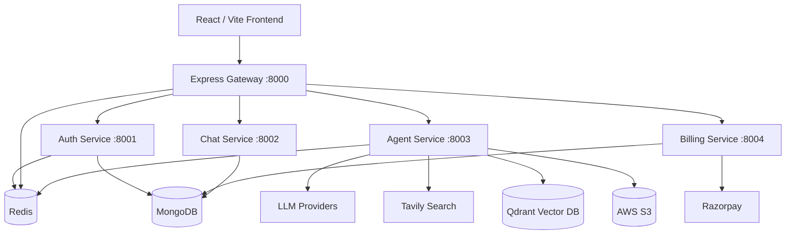

# CortexAI

CortexAI is a web-based AI assistant with a ChatGPT-style interface. It combines a React frontend with a Node.js microservice backend and routes requests to specialized AI workflows. It supports conversational AI, web search, code generation/review, PDF creation, PowerPoint creation, image generation, image understanding, and question-answering over uploaded PDFs.


## Contents

- [Overview](#overview)
- [Features](#features)
- [Technology stack](#technology-stack)
- [Architecture](#architecture)
- [Request flow](#request-flow)
- [Project structure](#project-structure)
- [Prerequisites](#prerequisites)
- [External services and credentials](#external-services-and-credentials)
- [Environment variables](#environment-variables)
- [Installation and local development](#installation-and-local-development)
- [Run the services](#run-the-services)
- [Frontend configuration](#frontend-configuration)
- [Available API endpoints](#available-api-endpoints)
- [Agent routing and behavior](#agent-routing-and-behavior)
- [Credits and plans](#credits-and-plans)
- [Data models](#data-models)
- [File handling](#file-handling)
- [Docker notes](#docker-notes)
- [Troubleshooting](#troubleshooting)
- [Security notes](#security-notes)
- [Limitations and implementation notes](#limitations-and-implementation-notes)

## Overview

CortexAI provides a single interface for interacting with multiple AI capabilities. A user signs in with Google, starts or revisits conversations, sends prompts, optionally uploads files, and selects an agent or uses automatic routing. The backend stores conversations and messages, maintains short-term chat context in Redis, checks agent request limits, and deducts credits for successful AI operations.

The backend is divided into services so authentication, conversation storage, AI orchestration, and billing can run independently.

## Features

- **Google sign-in:** Google OAuth popup using Firebase Authentication; the backend verifies the Firebase ID token.
- **Conversation management:** create conversations, list conversations, rename conversations, and load message history.
- **AI chat:** general-purpose conversation using a Groq-hosted model.
- **Web search:** Tavily search; search results (including images) are passed into the chat agent to formulate an answer.
- **Coding assistant:** code generation produces downloadable/editable project artifacts; other coding intents can produce code explanations, reviews, debugging guidance, optimization, conversion, or documentation.
- **PDF generation:** generate a structured PDF document from a topic and return a temporary download link.
- **PowerPoint generation:** create a presentation with a title/subtitle and six content slides, then return a download link.
- **PDF question answering:** upload a PDF, extract its text, split it into chunks, index chunks in Qdrant, retrieve relevant chunks, and answer using the retrieved content.
- **Image analysis:** upload an image and ask a question; the vision model can describe the image, extract visible text, and interpret charts/tables.
- **Image generation:** transform the prompt into a detailed image prompt and request an image from the Pollinations image endpoint; store the resulting image in S3 and provide a temporary link.
- **Usage credits:** account credits are charged according to the requested agent.
- **Per-agent rate limits:** Redis-based counters limit requests per agent over a 60-second window.
- **Responsive frontend UI:** React-based chat interface with sidebar, messages, chat input, loading animation, and artifact display.

## Technology stack

### Frontend

- React 19
- Vite
- Redux Toolkit / React Redux
- Tailwind CSS v4 with the Vite plugin
- Axios
- Firebase client SDK (Google Authentication)
- React Markdown + remark-gfm
- Monaco Editor (artifact/code editing)
- Lucide React, React Icons, Motion

### Backend

- Node.js (ES modules)
- Express 5
- MongoDB with Mongoose
- Redis with ioredis
- Firebase Admin SDK (token verification)
- LangChain and LangGraph for agent orchestration
- Groq, Google Gemini, and OpenRouter model providers
- Tavily for web search
- Qdrant for vector retrieval
- AWS S3 for generated file/image storage and signed downloads
- Razorpay for payment orders and payment signature verification
- Multer for uploaded files
- PDFKit and pdf-parse
- pptxgenjs

## Architecture

The backend has a gateway and four services:


| Component | Default port | Responsibility |
|---|---:|---|
| Frontend (Vite) | 5173 | UI, Firebase Google sign-in, API calls, conversation display, artifacts |
| Gateway | 8000 | Browser-facing API, session-cookie authentication, service proxying |
| Auth service | 8001 | Firebase token verification, user creation/login, logout, plan/credit updates |
| Chat service | 8002 | Conversation and message persistence in MongoDB |
| Agent service | 8003 | LangGraph workflow, AI agents, file processing, credits/rate-limit checks |
| Billing service | 8004 | Razorpay order creation and payment verification |
| Redis | 6379 | Sessions, conversation-memory cache, rate-limit counters |




The repository includes a Docker Compose file for Redis only. The other backend services and frontend are started individually for local development (see below). The service Dockerfiles exist, but the current Compose file does not orchestrate the entire application.

## Request flow

1. The user signs in with Google from the frontend using Firebase Authentication.
2. The frontend sends the Firebase ID token to the Gateway's auth proxy route.
3. The Auth service validates the token with Firebase Admin, finds or creates the user record, and creates a Redis session. The session ID is returned as an HTTP cookie.
4. For protected requests, the Gateway reads the session cookie, looks up the session in Redis, and attaches the authenticated user to the request.
5. The Gateway proxies the request to Chat, Agent, or Billing services. For protected service requests, it forwards the user ID in the `x-user-id` header.
6. The Agent service saves the user's prompt to the Chat service, invokes the LangGraph graph, updates Redis conversation memory, saves the assistant response, and returns the response/artifacts to the frontend.
7. Agent operations check Redis rate limits and deduct credits through the Auth service.

## Project structure

```text
cortexAI/
└── 1.cortexAI/
    ├── .github/workflows/deploy.yml
    ├── backend/
    │   ├── docker-compose.yml          # Redis only
    │   ├── gateway/                   # Browser-facing API gateway
    │   ├── services/
    │   │   ├── auth/                  # Firebase authentication, user/credits
    │   │   ├── chat/                  # Conversation/message MongoDB APIs
    │   │   ├── agent/                 # LangGraph + AI agents
    │   │   └── billing/                # Razorpay billing
    │   └── shared/redis/               # Shared Redis connection
    └── frontend/
        ├── src/
        │   ├── components/             # UI components
        │   ├── features/               # API request helpers
        │   ├── pages/                  # Pages
        │   ├── redux/                  # Redux slices/store
        │   └── assets/
        └── utils/                       # Axios/Firebase setup
```

### Important frontend modules

- `src/pages/Home.jsx`: main app view, Google login, sidebar/chat/artifact layout.
- `src/components/SideBar.jsx`: conversations and navigation controls.
- `src/components/ChatArea.jsx`: conversation display and interaction.
- `src/components/ChatInput.jsx`: prompt entry and file upload UI.
- `src/components/MessageBubble.jsx`, `MessageList.jsx`: message rendering.
- `src/components/Artifact.jsx`: generated coding artifacts/files UI.
- `src/components/BillingDrawer.jsx`: plan/credits/payment UI.
- `src/features/`: API helper functions for auth, chat, agents, billing.
- `src/redux/`: user, conversation, message state and store.

### Important backend modules

- `backend/gateway/index.js`: gateway setup and proxy routes.
- `backend/gateway/middleware/auth.middleware.js`: Redis-session authentication middleware.
- `backend/gateway/utils/proxyWithHeader.js`: proxy helper forwarding `x-user-id`.
- `backend/services/agent/graph/graph.js`: LangGraph workflow and node wiring.
- `backend/services/agent/graph/router.js`: automatic/manual agent selection.
- `backend/services/agent/agents/`: individual agent implementations.
- `backend/services/agent/config/llmModels.js`: provider/model configuration.
- `backend/services/agent/config/memory.js`: Redis chat history cache.
- `backend/services/agent/config/agentLimit.js`: per-agent request limits.
- `backend/services/auth/models/user.model.js`: user schema.
- `backend/services/chat/models/`: conversation and message schemas.
- `backend/services/billing/config/Plans.js`: plan definitions.

## Prerequisites

Install the following before starting the project:

- Node.js and npm (use a recent LTS release compatible with the package dependencies)
- Git
- Docker Desktop / Docker Engine and Docker Compose (recommended for Redis)
- MongoDB database (local MongoDB or MongoDB Atlas)
- Redis
- Firebase project configured for Google sign-in, including a Firebase Admin service-account JSON
- API keys/credentials for the AI and integrations you intend to use (see next section)

## External services and credentials

CortexAI currently integrates with these external services. Create/configure credentials before running the corresponding features:


| Service | Used for | Required configuration |
|---|---|---|
| Firebase | Google sign-in and backend token validation | Web app config and Admin service-account JSON |
| MongoDB | Users, conversations, messages, payment records | Connection URI |
| Redis | Login sessions, chat-memory cache, rate-limit counters | Redis URL or local Redis endpoint |
| Groq | Chat, search-answer synthesis, and several agent workflows | API key |
| Google Gemini | Image understanding and embeddings | Google API key |
| OpenRouter | Coding workflow model | API key |
| Tavily | Web search | API key |
| Qdrant | PDF RAG vector storage | URL and API key if your Qdrant deployment requires it |
| AWS S3 | Generated PDF/PPT/image file storage and signed downloads | Region, credentials, bucket |
| Razorpay | Paid plan orders and payment verification | Key ID and secret |
| Pollinations | Image generation endpoint | The current implementation calls the image endpoint directly; check provider terms/availability |

## Environment variables

Create local environment files for each service. **Do not commit real `.env` files or service-account credentials.** Variable names used by the current code are listed below. Values, hostnames, keys, and secrets must be supplied by your own environment.

### `backend/gateway/.env`

```dotenv
PORT=8000
AUTH_SERVICE=http://localhost:8001
CHAT_SERVICE=http://localhost:8002
AGENT_SERVICE=http://localhost:8003
BILLING_SERVICE=http://localhost:8004
FRONTEND_URL=http://localhost:5173
REDIS_URL=redis://localhost:6379
```

### `backend/services/auth/.env`

```dotenv
PORT=8001
MONGODB_URI=mongodb://localhost:27017/cortexai-auth
REDIS_URL=redis://localhost:6379
```

### `backend/services/chat/.env`

```dotenv
PORT=8002
MONGODB_URI=mongodb://localhost:27017/cortexai-chat
```

### `backend/services/agent/.env`

```dotenv
PORT=8003
MONGODB_URI=mongodb://localhost:27017/cortexai-agent
GROQ_API_KEY=your_groq_api_key
GOOGLE_API_KEY=your_google_api_key
CHAT_SERVICE=http://localhost:8002
AUTH_SERVICE=http://localhost:8001
REDIS_URL=redis://localhost:6379
TAVILY_API_KEY=your_tavily_api_key
OPENROUTER_API_KEY=your_openrouter_api_key
AWS_REGION=your_aws_region
AWS_ACCESS_KEY_ID=your_aws_access_key_id
AWS_SECRET_KEY=your_aws_secret_access_key
AWS_BUCKET_NAME=your_s3_bucket_name
QDRANT_API_KEY=your_qdrant_api_key_if_required
QDRANT_URL=your_qdrant_url
```

### `backend/services/billing/.env`

```dotenv
PORT=8004
MONGODB_URI=mongodb://localhost:27017/cortexai-billing
AUTH_SERVICE=http://localhost:8001
RAZORPAY_KEY_ID=your_razorpay_key_id
RAZORPAY_KEY_SECRET=your_razorpay_key_secret
```

### `frontend/.env`

```dotenv
VITE_FIREBASE_API_KEY=your_firebase_web_api_key
VITE_RAZORPAY_KEY_ID=your_razorpay_key_id
VITE_SERVER_URL=http://localhost:8000
```

### Firebase setup

1. Create a Firebase project and add a Web app.
2. Enable Google as a sign-in provider in Authentication.
3. Add the local frontend host (usually `localhost`) to Firebase Authentication's authorized domains.
4. Place the Firebase Web configuration in the frontend Firebase initialization module (`frontend/utils/firebase.js`). The current checked-in source uses a config object directly; migrate it to environment variables before sharing/deploying.
5. Generate a Firebase Admin service-account key for backend token validation.
6. Place the JSON at `backend/services/auth/serviceAccountKey.json` because the current `backend/services/auth/config/firebase.js` imports this file directly. Keep this file private and out of Git.


## Installation and local development

### 1. Clone the repository

```bash
git clone <YOUR_GITHUB_REPOSITORY_URL>
cd <REPOSITORY_FOLDER>
```

Navigate to the project root (the directory containing `backend/` and `frontend/`). In the uploaded archive, this directory is named `1.cortexAI`.

### 2. Configure credentials and environment files

Create the five `.env` files using the templates above, and set up the Firebase Admin JSON file. Make sure your MongoDB and Redis URLs are correct and that all third-party credentials are valid.

### 3. Start Redis

From the `backend/` directory:

```bash
docker compose up -d redis
```

Confirm Redis is running:

```bash
docker compose ps
```

If Redis is installed locally instead of using Docker, start it using your platform's service manager and use the matching Redis URL in environment files.

### 4. Install backend dependencies

Install dependencies separately in each service directory:

```bash
cd gateway && npm install
cd ../services/auth && npm install
cd ../services/chat && npm install
cd ../services/agent && npm install
cd ../services/billing && npm install
```

Run these commands from `backend/` (the relative paths above assume you start in `backend/`). The project has individual `package.json` files for the gateway and each service.

### 5. Install frontend dependencies

From the `frontend/` directory:

```bash
npm install
```

### 6. Verify your configuration

Before launching, check that:

- MongoDB is reachable from Auth, Chat, and Billing (and Agent if its DB configuration is used).
- Redis is reachable by Gateway, Auth, and Agent.
- The service URLs in the environment files match the ports and hosts you are running.
- Firebase Google sign-in is configured and the Admin service-account file is in the expected path.
- External keys are valid for the features you want to test.

## Run the services

Start each process in a separate terminal. Start Redis and the databases/integrations first.


### Terminal 1 — Gateway

```bash
cd backend/gateway
npm run dev
```

### Terminal 2 — Auth service

```bash
cd backend/services/auth
npm run dev
```

### Terminal 3 — Chat service

```bash
cd backend/services/chat
npm run dev
```

### Terminal 4 — Agent service

```bash
cd backend/services/agent
npm run dev
```

### Terminal 5 — Billing service

```bash
cd backend/services/billing
npm run dev
```

### Terminal 6 — Frontend

```bash
cd frontend
npm run dev
```

Vite prints the local URL (normally `http://localhost:5173`). Open that URL in a browser. The frontend uses `VITE_SERVER_URL` to communicate with the gateway.

To run a service in production mode, use `npm start` in its respective service directory. For frontend production assets, run `npm run build` and then serve the generated `dist/` directory using a suitable static host.

## Available API endpoints

All browser-facing API calls should go through the Gateway (normally `http://localhost:8000`). The Gateway proxies `/api/auth`, `/api/chat`, `/api/agent`, and `/api/billing` to their respective services. Protected routes require a valid session cookie.

### Authentication (`/api/auth`)

| Method | Path | Purpose |
|---|---|---|
| POST | `/api/auth/login` | Verify Firebase ID token, login/create account, establish session |
| GET | `/api/auth/logout` | Log out and clear session |
| POST | `/api/auth/update-plan` | Internal endpoint to update user plan and add credits |
| POST | `/api/auth/deduct-credits` | Internal endpoint to subtract credits for an operation |

### Current user (`/api`)

| Method | Path | Purpose |
|---|---|---|
| GET | `/api/me` | Get the authenticated user/session data |

### Conversations and messages (`/api/chat`)

| Method | Path | Purpose |
|---|---|---|
| GET | `/api/chat/create-conversation` | Create a new conversation |
| GET | `/api/chat/get-conversations` | List the current user's conversations |
| POST | `/api/chat/update-conversation` | Rename/update a conversation title (body contains `id` and `title`) |
| POST | `/api/chat/save-message` | Save a message (body contains conversation ID, role, content, optional images/artifacts) |
| GET | `/api/chat/get-messages/:conversationId` | Load messages for a conversation |

### AI (`/api/agent`)

| Method | Path | Purpose |
|---|---|---|
| POST | `/api/agent/chat` | Send a prompt, optional file, and optional agent selection |

`/api/agent/chat` uses multipart/form-data when uploading a file. Form fields include:

- `prompt`: user prompt text
- `conversationId`: conversation identifier
- `agent`: agent name or `auto` (the current graph router supports an agent override)
- `file`: optional uploaded file, field name must be `file`

### Billing (`/api/billing`)

| Method | Path | Purpose |
|---|---|---|
| POST | `/api/billing/create` | Create a Razorpay order for a plan (body: `{ "plan": "starter" }` or `{ "plan": "pro" }`) |
| POST | `/api/billing/verify` | Verify Razorpay payment (body contains `razorpay_order_id`, `razorpay_payment_id`, and `razorpay_signature`) |

> Note: Service routes are mounted through the Gateway. The current backend implementation uses internal service URLs and `x-user-id` headers for some operations; do not expose internal endpoints publicly without reviewing access controls.

## Agent routing and behavior

The Agent service uses a LangGraph graph with a router node and specialized nodes. In automatic mode, the router classifies the prompt. If an uploaded file is present, the router currently prioritizes PDF uploads to the PDF-RAG workflow and image uploads to image analysis. If a non-`auto` agent value is supplied, the router uses that selection.

| Agent | Typical task | Implementation notes |
|---|---|---|
| `chat` | General conversation, explanations, learning questions | Uses chat model and conversation history |
| `search` | Recent/current information or web lookup | Tavily search; results flow into the chat node for response synthesis |
| `coding` | Code generation or code-related help | Intent classification; generation returns structured project files/artifacts; other intents return Markdown |
| `pdf` | Create a PDF from a topic | LLM creates structured sections; PDFKit renders; output stored in S3 with a signed link |
| `ppt` | Create slides | LLM creates slide content; pptxgenjs renders a 6-slide presentation; file stored in S3 |
| `vision` | Generate an image from a prompt | Prompt refinement followed by Pollinations image endpoint; image stored in S3 |
| `pdfRag` | Ask questions about an uploaded PDF | Extract, chunk, embed, index in Qdrant, retrieve top relevant chunks, answer based on them |
| `imageAnalyzer` | Ask about an uploaded image | Gemini vision model processes the uploaded image and prompt |

### Automatic routing notes

- Text prompts are classified into a route by the router LLM.
- The router's prompt lists `chat`, `search`, `coding`, `pdf`, `ppt`, and `vision` as choices.
- The graph contains nodes for `pdfRag` and `imageAnalyzer` too; file MIME type automatically selects these workflows.
- The search node is connected to the chat node so the assistant can summarize search results in a user-friendly response.
- Explicit agent selection bypasses automatic classification, so the frontend selection must use names understood by the graph.

## Credits and plans

### Plan configuration

The current plan definitions are:


| Plan | Price (INR) | Credits | Validity |
|---|---:|---:|---:|
| Free | ₹0 | 100 | 30 days (configured validity) |
| Starter | ₹199 | 500 | 30 days |
| Pro | ₹499 | 1,000 | 30 days |

Plan values are configured in `backend/services/billing/config/Plans.js`.

### Credit costs

The Auth service's credit-deduction endpoint defines these operation costs:

| Agent operation | Credits per request |
|---|---:|
| Chat | 1 |
| Search | 5 |
| Coding | 10 |
| PDF | 10 |
| PPT | 10 |
| Vision/image | 10 |

The Agent service also has per-agent rate limits (counters reset after 60 seconds):

| Operation | Requests per minute |
|---|---:|
| Chat | 20 |
| Coding | 5 |
| PDF | 5 |
| PPT | 5 |
| Image/vision | 5 |
| Search | 5 |

Credit charging and limits are implemented in the backend. Verify these values and enforcement behavior before changing pricing or publishing production plans.

## Data models

### User

Stored in MongoDB by the Auth service:

- `firebaseUid` (unique Firebase user ID)
- `name`
- `email`
- `avatar`
- `plan` (defaults to `free`)
- `credits` (defaults to 100)
- `totalCredits` (defaults to 100)
- `planExpiresAt`
- timestamps (`createdAt`, `updatedAt`)

### Conversation

Stored by Chat service:

- `title` (defaults to `New Chat`)
- `userId`
- timestamps

### Message

Stored by Chat service:

- `conversationId` (MongoDB Conversation reference)
- `role` (`user` or `assistant`)
- `content`
- optional `images` array
- optional `artifacts` array (artifact ID/type/title/files)
- timestamps

### Payment

Stored by Billing service:

- `userId`
- `orderId`
- `paymentId`
- `amount`
- `currency` (defaults to INR)
- `credits`
- `plan`
- `status` (`created`, `paid`, or `failed`)
- timestamps

## File handling

- The Agent route accepts a multipart upload field named `file`.
- PDF uploads are read and parsed, then split into text chunks (chunk size 1,000 characters and overlap 200 characters) for retrieval.
- Qdrant stores PDF vectors in a collection with a generated name. Embeddings use Google's `gemini-embedding-001` model.
- Image analysis reads the uploaded image, sends the image and user prompt to the configured Gemini vision model, and removes the temporary upload afterward.
- Generated PDFs, PowerPoints, and images are uploaded to S3.
- Generated downloads use signed URLs. The current implementation requests short expirations (PDF/image links are intended to be short-lived; PPT generation requests a 24-hour S3 URL, while the displayed text in the agent currently says 10 minutes—verify this mismatch in code before relying on it).
- PDF parsing and image analysis use temporary files. Make sure the upload folder exists and has suitable write permissions; check the Multer config for accepted file types and limits.

## Docker notes

- `backend/docker-compose.yml` currently defines Redis only.
- Individual backend Dockerfiles are present for Gateway, Auth, Chat, Agent, and Billing.
- The Dockerfiles expect the backend root context and copy shared code plus each service into a container. If building them, use the backend directory as the build context and inspect each Dockerfile's expected paths.
- A full multi-service Compose stack (including MongoDB, Qdrant, all application services, frontend, environment variables, and service health checks) is not currently provided in this repository.


## Troubleshooting

| Problem | Checks / possible fix |
|---|---|
| Frontend cannot reach API | Confirm `VITE_SERVER_URL`, Gateway port, CORS `FRONTEND_URL`, and that Gateway is running |
| Google sign-in fails | Check Firebase web config, enabled Google provider, authorized domains, and popup/browser restrictions |
| Login succeeds but API returns unauthorized | Check Redis connectivity, cookie settings, Gateway session lookup, and browser cookie behavior |
| MongoDB connection errors | Verify each service's `MONGODB_URI`, database availability, and network access rules |
| Redis errors | Start Redis and confirm `REDIS_URL` is correct for Gateway/Auth/Agent |
| Chat/AI calls fail | Confirm provider API keys, model/provider availability, service-to-service URLs, and logs |
| Search returns no results | Verify Tavily key and inspect search-agent logs/results |
| PDF RAG errors | Confirm PDF upload works, Google API key, Qdrant URL/key, and vector collection creation |
| Generated files/images fail | Check AWS credentials, region, bucket policy, S3 permissions, and provider response |
| Billing/payment fails | Use Razorpay test keys, verify order/payment IDs and signature handling, and confirm Auth service URL |
| Rate-limit response | Wait for the 60-second window to expire; inspect Redis rate keys |
| Frontend build/lint errors | Run `npm run build` or `npm run lint` from `frontend/` and address reported issues |

## Security notes

**Before making this repository public or asking someone to clone it, audit the existing Git history and files.** The provided project archive contains environment files and a Firebase Admin service-account JSON file. These are sensitive and must not be committed or shared.

1. Revoke/rotate any credentials that were ever committed or included in a shared archive (API keys, cloud credentials, payment secrets, Firebase service-account key, etc.). Removing a secret from the latest commit is not enough if it exists in Git history.
2. Remove committed `.env` files and `serviceAccountKey.json` from the repository, add them to `.gitignore`, and replace them with safe `.env.example` files containing placeholders.
3. Keep Firebase web configuration in environment variables. Firebase web API keys are not equivalent to server secrets, but restrict them in Firebase/Google Cloud and use appropriate security rules.
4. Never expose AWS secret keys, Razorpay secrets, Firebase Admin private keys, AI-provider keys, or database credentials in frontend code or public Git.
5. Validate authorization on all service endpoints, ownership of conversation/message IDs, upload size/type, and billing actions before production use. Review CORS, cookies, session expiration, payment verification, rate limiting, and error handling.
6. Do not use real payment credentials for development. Use Razorpay test mode.

## Limitations and implementation notes

- The current repository is a development-oriented implementation; review security, reliability, validation, and error handling before production deployment.
- Redis is used for session and memory caching. Chat history is cached for up to 24 hours on initial retrieval, and the current memory helper maintains a rolling window of up to 20 messages.
- MongoDB is used by Auth, Chat, and Billing; the Agent service has a MongoDB configuration file as well, though its primary workflow uses the Chat service, Redis, Qdrant, and external AI services.
- Model provider selection is hard-coded in `backend/services/agent/config/llmModels.js`. Provider/model availability may change; review this file to update model names and routing.
- Rate limits and credit costs are hard-coded in their configuration/controller files.
- Temporary signed download URL duration and user-facing expiry text may not always match. Verify `getFromS3.js` and the relevant agents before relying on displayed expiration claims.
- The root `backend/docker-compose.yml` does not start the full application.
- No complete automated test suite is included; the service package scripts primarily provide development/start commands.

## Contributing / extending

1. Create or update the agent implementation in `backend/services/agent/agents/`.
2. Add the agent to the LangGraph workflow in `backend/services/agent/graph/graph.js`.
3. Update router classification and the conditional graph mapping in `backend/services/agent/graph/router.js` if automatic routing should reach it.
4. Configure the model/provider in `backend/services/agent/config/llmModels.js` if needed.
5. Add credit cost and request limits in the appropriate configuration/controller files.
6. Add frontend agent selection and display behavior as needed.
7. Test the feature locally and document new environment variables or external services.

## License

The repository currently does not define a project-level license. Add a `LICENSE` file before granting others permission to reuse, modify, or distribute the project.

